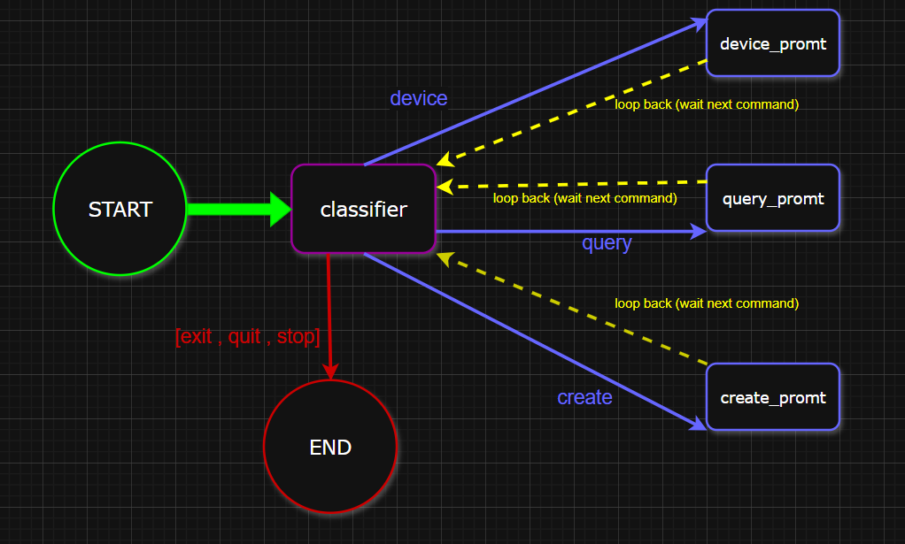

# Medical-voice-mcp


## Quick Overview
This project is a functional prototype of **ScrubVoice**, designed for **doctors**.It runs entirely on a local **Ollama** instance orchestrated by a stateful **LangGraph** architecture. Using local Speech-to-Text (STT) and Text-to-Speech (TTS) libraries, the system captures spoken clinical commands directly from the microphone and articulates AI responses aloud in real time.

**No API keys or cloud subscriptions are required**—the entire inference, state routing, and audio pipeline runs 100% locally and cost-free.

## Problem & Purpose

### The Problem
During surgery, the surgeon's hands are sterile and their eyes must remain fixed on the patient.
Manually checking monitors or retrieving patient data interrupts the surgical workflow, while conventional equipment only sounds generic alarms rather than alerting based on individualized thresholds.

### Primary Goal
- **Hands-Free EHR (via MCP):** Safely queries and updates the patient database while preserving surgical sterility.
- **Real-Time Telemetry:** Verbally reports live vital signs (e.g., blood pressure, SpO2) on demand.
- **Proactive Alerts:** Monitors patient-specific critical limits and verbally alerts the team when vitals deteriorate.
- **Voice-to-Record:** Converts spoken intraoperative notes and administered medication dosages directly into structured records.

---

## Quick Architecture Review
### Voice Agent
- **Speech Input**: Handled by the `listen_doctor()` function,using the local ```SpeechRecognition``` library and transcribes them into text.
- **Text Generation**: The local Ollama model processes the prompt and generates the response text.
- **Speech Output**: The generated response is passed directly to the `speak()` function as a string argument, which uses the local TTS engine (pyttsx3) to read the text aloud to the surgeon in real time.


### LangGraph Review



## Future Roadmap
- **Full MCP Protocol Client-Server Integration** : Replace in-memory mock databases with actual MCP
- **Automated Data Pipeline** : Create a data pipeline that automatically processes the data
- **Proactive Anomaly Detection & Audio Interrupts** : Automatically interrupting conversations with immediate audio alerts when critical thresholds are breached.

## Setup & Configuration

### 1. Install & Run Ollama

- **Windows:** Download and install `OllamaSetup.exe` from [ollama.com](https://ollama.com/).
- **Linux:** Run the installation script in your terminal:
  ```bash
  curl -fsSL https://ollama.com/install.sh | sh
  ```
- **macOS:** Download the `.dmg` installer from [ollama.com](https://ollama.com/) or install via Homebrew:
  ```bash
  brew install ollama
  ```

Pull the local language model:
```bash
ollama run llama3.2
```

---

### 2. Python Virtual Environment & Dependencies

Create and activate a virtual environment, then install the required dependencies:

```bash
# Create and activate virtual environment
python -m venv .venv

# Windows:
.venv\Scripts\activate

# Linux / macOS:
source .venv/bin/activate

# Install required packages
pip install langgraph langchain-ollama langchain-core pydantic speechrecognition pyttsx3
```

---

### 3.Voice Command & Testing

| Scenario / Branch | What You Say (Doctor Input) | Target LangGraph Node | Expected Response / System Output |
| :--- | :--- | :--- | :--- |
| **Patient DB Query** | `"What is the blood pressure of John Doe?"` | `query_prompt` | Verbal report from `PATIENTS_DB` (e.g., *"Blood pressure is 120 over 80. Oxygen saturation is 98 percent..."*). |
| **Patient DB Query** | `"Check vitals for Jane Smith."` | `query_prompt` | Verbal report confirming Jane's records and allergy status. |
| **Telemetry / Device** | `"Check the pulse oximeter."` | `device_prompt` | Real-time device readout (e.g., *"Pulse oximeter: 98%"*). |
| **Telemetry / Device** | `"What are the current monitor readings?"` | `device_prompt` | Combined telemetry report from `CurrentDevice` (blood pressure & SpO2). |
| **Record Creation** | `"Add a new patient record for Mark Taylor."` | `create_prompt` | Confirmation prompt (e.g., *"I recorded the new information into the registry."*). |
| **System Shutdown** | `"Exit"` or `"Stop ScrubVoice"` | `END` | Agent responds: *"ScrubVoice shutting down."* and cleanly terminates loop. |


